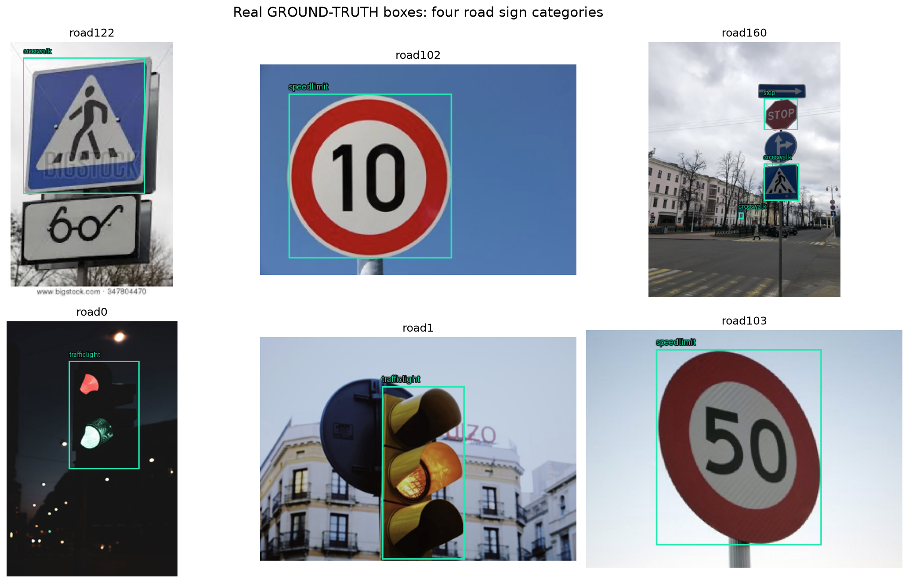
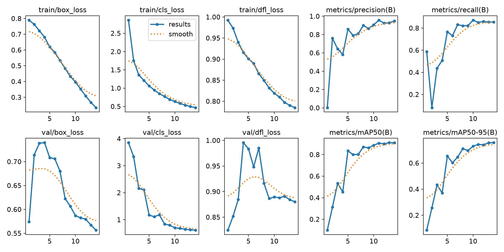
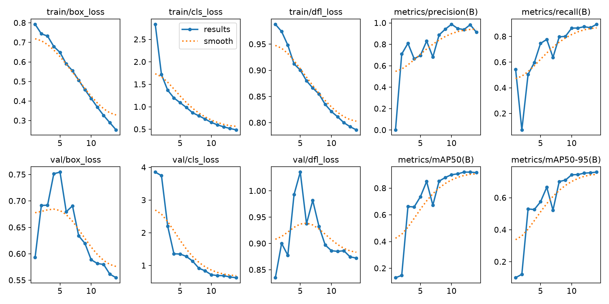
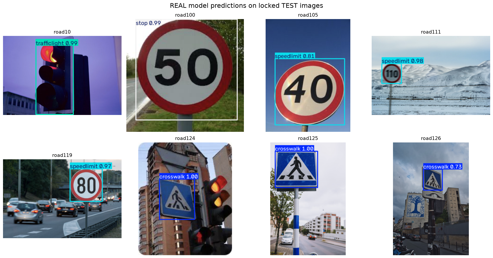
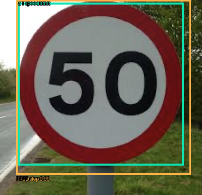
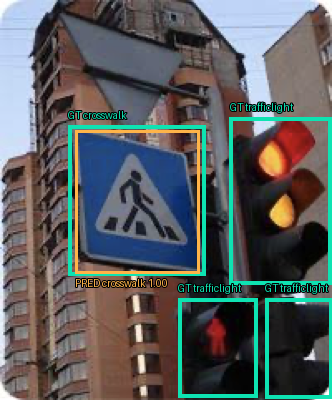
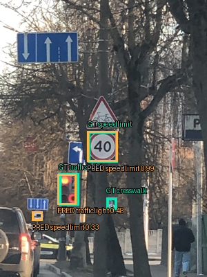

# Traffic Sign Detection with YOLO11n

**CSCI1409 Deep Learning · KBTU · Fall 2026 · Individual Bonus Project**

> **Status: completed.** Both controlled training runs, validation-based model
> selection and one locked-test evaluation were executed on November 20, 2026.
> This repository contains the executed notebook, measured evidence, selected
> checkpoint, presentation and two short demonstration videos.

## Result at a glance

| Selected model | Test Precision | Test Recall | Test mAP@0.50 | Test mAP@0.50:0.95 |
| --- | ---: | ---: | ---: | ---: |
| `experiment_brightness_035` | **0.9315** | **0.8717** | **0.9183** | **0.7403** |

**Research question:** does moderate HSV brightness augmentation improve
road-sign detection under varied lighting?

On this fixed split, changing only `hsv_v` from `0.00` to `0.35` increased
validation Recall from **0.8548 to 0.8915** and validation mAP@0.50 from
**0.9098 to 0.9184**, while validation Precision decreased from **0.9404 to
0.9198**. This is evidence for this experiment, not a claim that brightness
augmentation always improves performance.

## Project files

- [Executed notebook with all outputs](CSCI1409_Bonus_Traffic_Signs_Colab.ipynb)
- [Open the notebook in Google Colab](https://colab.research.google.com/github/ravonek/Traffic-Sign-Detection/blob/main/CSCI1409_Bonus_Traffic_Signs_Colab.ipynb)
- [Five-slide defense presentation](CSCI1409_Bonus_Traffic_Signs_Defense_3min.pptx)
- [Three-minute speech](CSCI1409_Bonus_Traffic_Signs_Speech_EN.md)
- [Defense questions and answers](DEFENSE_QA_RU_EN.md)
- [Russian reproduction guide](HOW_TO_RUN_RU.md)
- [Final checkpoint](weights/final_best.pt)
- [Original and predicted demo videos](demo/README.md)

## 1. Task and classes

The project fine-tunes a pretrained **YOLO11n object detector** to predict a
class, confidence and bounding box for four road-sign categories:

| ID | Class | Meaning |
| ---: | --- | --- |
| 0 | `crosswalk` | Pedestrian crossing sign |
| 1 | `speedlimit` | Speed-limit sign |
| 2 | `stop` | Stop sign |
| 3 | `trafficlight` | Traffic light or annotated signal head |

The detector is fine-tuned from `yolo11n.pt`; no new detection architecture is
claimed.

## 2. Dataset, audit and split

- **Original dataset:** [Road Sign Detection — andrewmvd](https://www.kaggle.com/datasets/andrewmvd/road-sign-detection)
- **Download used by the notebook:** [PaddleDetection PASCAL VOC archive](https://paddlemodels.bj.bcebos.com/object_detection/roadsign_voc.tar)
- **Original annotation format:** PASCAL VOC XML
- **Training annotation format:** normalized YOLO labels
- **Split seed:** `42`

The notebook validates missing annotations, unknown classes, image dimensions
and bounding boxes. Before splitting, images are grouped by SHA-256 and
perceptual hash (Hamming distance ≤ 4), so an exact or detected near-duplicate
group cannot cross splits. The provider hold-out is reserved as the final test
set.

| Split | Images | Objects | Crosswalk | Speedlimit | Stop | Trafficlight |
| --- | ---: | ---: | ---: | ---: | ---: | ---: |
| Train | 559 | 797 | 119 | 495 | 56 | 127 |
| Validation | 140 | 191 | 31 | 130 | 13 | 17 |
| Test | 178 | 256 | 50 | 158 | 22 | 26 |
| **Total** | **877** | **1,244** | **200** | **783** | **91** | **170** |

Source of truth: [`dataset_counts.csv`](evidence/dataset_counts.csv),
[`dataset_audit.json`](evidence/dataset_audit.json) and
[`split_manifest.csv`](evidence/split_manifest.csv).



**Leakage limitation:** original source-video IDs are unavailable. Perceptual
grouping reduces near-duplicate leakage but cannot prove that different frames
from the same source video remain in one split.

## 3. Model and execution environment

| Setting | Value |
| --- | --- |
| Detector | YOLO11n |
| Initial checkpoint | `yolo11n.pt` for both runs |
| Image size | 512 × 512 |
| Epochs | 14 |
| Batch size | 16 |
| Optimizer | SGD |
| Initial learning rate | 0.01 |
| Weight decay | 0.0005 |
| Random seed | 42, deterministic mode |
| Ultralytics | 8.3.220 |
| Python | 3.11.6 |
| Device used for the recorded run | Apple M3 CPU |

Mosaic, mixup, geometry transforms, flips, hue jitter and saturation jitter were
disabled in both runs. Full fixed settings are recorded in
[`controlled_experiment_config.json`](evidence/controlled_experiment_config.json).

## 4. Controlled experiment

The hypothesis was written before training: moderate brightness jitter may
improve validation mAP@0.50 across brighter and darker scenes. Exactly one
deliberate parameter changes:

| Setting | Baseline | Brightness experiment |
| --- | ---: | ---: |
| Run | `baseline_no_brightness` | `experiment_brightness_035` |
| `hsv_v` | **0.00** | **0.35** |
| Precision | 0.9404 | 0.9198 |
| Recall | 0.8548 | **0.8915** |
| mAP@0.50 | 0.9098 | **0.9184** |
| mAP@0.50:0.95 | 0.7559 | **0.7611** |
| Training time | 51.48 min | **49.35 min** |

The brightness run gained approximately **+0.0367 Recall** and **+0.0085
mAP@0.50**, with approximately **−0.0206 Precision**. The experiment run was
selected by the predefined rule: highest validation mAP@0.50, then validation
Precision as a tie-breaker. The test set was not used for selection or tuning.

Sources:
[`validation_table.csv`](evidence/validation_table.csv),
[`validation_comparison.json`](evidence/validation_comparison.json),
[`training_times.json`](evidence/training_times.json) and
[`model_selection.json`](evidence/model_selection.json).

| Baseline learning curves | Brightness-experiment learning curves |
| --- | --- |
|  |  |

## 5. Locked test evaluation

After validation selection, `experiment_brightness_035/best.pt` was copied to
`weights/final_best.pt` and evaluated on the locked test split once.

| Metric | Result |
| --- | ---: |
| Precision | **0.9315** |
| Recall | **0.8717** |
| mAP@0.50 | **0.9183** |
| mAP@0.50:0.95 | **0.7403** |

Evaluation settings:

- confidence cutoff: `0.001`;
- NMS IoU: `0.70`;
- AP matching IoU: `0.50`;
- prediction-figure confidence: `0.25`.

Source of truth: [`test_metrics.json`](evidence/test_metrics.json).



## 6. Manually reviewed failure cases

Green boxes are ground truth and orange boxes are predictions. The three
exported cases were manually inspected on November 21, 2026. Causes below are
clearly separated from direct observations.

| Case | Evidence | Direct observation | Cause hypothesis | Possible improvement |
| --- | --- | --- | --- | --- |
| `road100.png` | [](evidence/failure_01.png) | The ground-truth object is a circular speed-limit 50 sign; the model predicts `stop` with 0.99 confidence over the same sign. | The model may rely too strongly on dominant sign appearance instead of internal digits; the image alone does not establish the cause. | Add more difficult speed-limit/stop negatives and inspect class-specific confusion. |
| `road124.png` | [](evidence/failure_02.png) | The crosswalk is detected at 1.00, but all three annotated traffic-light objects are missed. The upper-right light is partly cropped; the two lower signals are small and dark. | Object scale, cropping and pedestrian-signal appearance may contribute. | Add more varied traffic-light examples and evaluate higher-resolution/small-object training. |
| `road319.png` | [](evidence/failure_03.png) | The speed-limit sign and traffic light are detected. The very small crosswalk is not matched; an overlapping 0.33-confidence box is labeled `speedlimit`. | The distant sign's small scale may increase localization and class ambiguity. | Add small/distant crosswalk examples or test a larger input size in a new controlled study. |

Machine-generated matching details and the manual-review fields are preserved in
[`failure_analysis_candidates.json`](evidence/failure_analysis_candidates.json).

## 7. Checkpoint and inference

The real selected checkpoint is committed because its size is only 5.44 MB,
well below GitHub's per-file limit.

- **Repository file:** [`weights/final_best.pt`](weights/final_best.pt)
- **Direct download:** [final_best.pt](https://raw.githubusercontent.com/ravonek/Traffic-Sign-Detection/main/weights/final_best.pt)
- **SHA-256:** `7d3a5c1bec29855be12fd5c065e26ae983fb44af5dd2bc1063e8887146381d1d`
- **Verified identity:** byte-for-byte equal to
  `experiment_brightness_035_best.pt` from the artifact bundle.

```python
from ultralytics import YOLO

model = YOLO("weights/final_best.pt")
results = model.predict(
    source="path/to/image_or_video.mp4",
    imgsz=512,
    conf=0.25,
    iou=0.70,
    save=True,
)
```

## 8. Video demonstration

The repository includes the same 15-second, 1280×720, 30 fps road sequence
before and after inference:

| Original scene | YOLO11n detections |
| --- | --- |
| [`road_drive_15s_raw.mp4`](demo/road_drive_15s_raw.mp4) | [`road_drive_15s_yolo11n_predicted.mp4`](demo/road_drive_15s_yolo11n_predicted.mp4) |

These videos are qualitative evidence only and do not replace the held-out test
metrics.

## 9. Reproduce the experiment

### Google Colab

1. Open the [executed notebook in Colab](https://colab.research.google.com/github/ravonek/Traffic-Sign-Detection/blob/main/CSCI1409_Bonus_Traffic_Signs_Colab.ipynb).
2. To reproduce from scratch, choose **Runtime → Restart session**, select a GPU
   if available, and run all cells in order.
3. The notebook downloads the public VOC archive, audits and converts labels,
   creates the seeded grouped split, trains both runs, selects on validation,
   evaluates the locked test set and exports
   `TRAFFIC_SIGN_SUBMISSION_ARTIFACTS.zip`.

### Local environment

```bash
git clone https://github.com/ravonek/Traffic-Sign-Detection.git
cd Traffic-Sign-Detection
python -m venv .venv
source .venv/bin/activate
python -m pip install -r requirements.txt
jupyter notebook CSCI1409_Bonus_Traffic_Signs_Colab.ipynb
```

The source code selects `/content/traffic_sign_bonus` in Colab and a project-local
`traffic_sign_bonus` directory elsewhere; no machine-specific absolute path is
required for a new run. See [`HOW_TO_RUN_RU.md`](HOW_TO_RUN_RU.md) for details.

To rebuild the presentation from an exported artifact bundle:

```bash
python scripts/build_defense.py --artifacts TRAFFIC_SIGN_SUBMISSION_ARTIFACTS.zip
```

## 10. Repository structure

```text
Traffic-Sign-Detection/
├── README.md
├── requirements.txt
├── CSCI1409_Bonus_Traffic_Signs_Colab.ipynb       # executed, 10/10 code cells
├── CSCI1409_Bonus_Traffic_Signs_Defense_3min.pptx # measured results
├── CSCI1409_Bonus_Traffic_Signs_Speech_EN.md
├── DEFENSE_QA_RU_EN.md
├── HOW_TO_RUN_RU.md
├── PROJECT_STATUS.txt
├── demo/
│   ├── road_drive_15s_raw.mp4
│   └── road_drive_15s_yolo11n_predicted.mp4
├── evidence/                                      # genuine exported evidence
├── scripts/
│   └── build_defense.py
└── weights/
    └── final_best.pt                              # selected checkpoint
```

## Limitations and integrity

- The dataset is small and class-imbalanced.
- Only one training run was executed per condition, so run-to-run variance is
  not measured.
- Source-video IDs are unavailable.
- Domain shift, small objects, occlusion and unusual signal types remain
  challenging.
- This educational detector is not validated for safety-critical deployment.
- AI assistance was used for implementation structure, documentation and
  presentation drafting. The student executed the experiments, preserved the
  outputs and is responsible for explaining and verifying the work.

The dataset photographs are not redistributed in this repository. Dataset and
PaddleDetection sources are credited above. Ultralytics' open-source software is
subject to its own licensing terms.

---

**Course:** CSCI1409 Deep Learning · **Defense:** November 21, 2026 · **Maximum:** 3 bonus points
